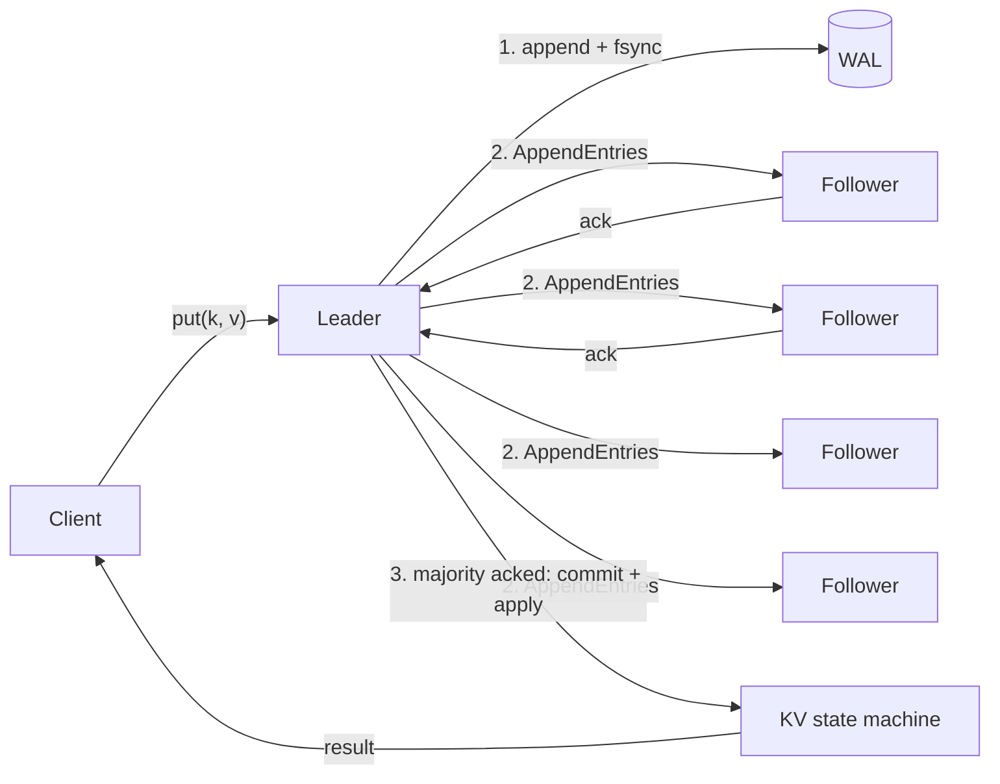

# raft-kv

[](https://github.com/PhiMaii/raft-kv/actions/workflows/ci.yml)
[](#license)
[](https://phimaii.github.io/raft-kv/)

A replicated, linearizable key-value store built from scratch on the
[Raft](https://raft.github.io/) consensus algorithm, written in Rust.

The goal is a system small enough to understand end to end, but correct under
real failures, with evidence for that correctness that anyone can reproduce
from this repository: deterministic simulation testing, a linearizability
checker, and a real-process fault-injection harness.

> **Status: work in progress.** The milestones are listed in the
> [specification](docs/src/spec.md#4-suggested-milestones-16-weeks).
> Sections marked _TBD_ below are filled in as each milestone lands.

## Guarantees

- **Linearizable.** Every read sees the latest committed write, even during a
  leader change. Writes go through the Raft log; reads use ReadIndex.
- **No lost acknowledged writes.** An acknowledged write survives as long as a
  majority of nodes (3 of 5) keep their disks. Up to 2 nodes can crash,
  restart or lose their network at any time. If 3 or more are down, the cluster
  stops accepting writes until enough nodes come back, instead of losing data.
- **Not covered:** Byzantine faults, a majority of nodes losing their disks,
  and wide-area deployments.

## Architecture



The core design rule: the Raft state machine (`raft-core`) is deterministic
and performs no I/O. Time, randomness, networking and disk access are injected
from outside. This makes the whole cluster testable in a single-process,
seed-driven simulator.

## Quickstart

You need a Rust toolchain ([rustup](https://rustup.rs)); everything else,
including the Protocol Buffers compiler, comes with the build. Start a
five-node cluster on ports 7001–7005:

```sh
scripts/cluster.sh start
```

Then talk to it. The client finds the leader on its own:

```sh
target/release/raft-kv put greeting hello
target/release/raft-kv get greeting                         # hello
target/release/raft-kv cas greeting hi --expected hello     # swapped
target/release/raft-kv del greeting
scripts/cluster.sh status                                   # role, term, log progress per node
```

Crash the leader and watch the cluster carry on:

```sh
scripts/cluster.sh kill 3      # SIGKILL node 3, say it is the leader
scripts/cluster.sh status      # the others elect a new leader
target/release/raft-kv get greeting
scripts/cluster.sh start 3     # node 3 recovers from disk and catches up
scripts/cluster.sh clean       # stop everything and delete the data
```

Logs are in `data/logs/`, data in `data/node1` … `data/node5`.

### With Docker

```sh
docker compose up -d --build
docker compose exec node1 raft-kv put greeting hello
docker compose exec node1 raft-kv status
docker compose kill node2 && docker compose start node2
docker compose down -v
```

Client commands run inside a container because the nodes know each other
by their Compose host names.

## Testing

The main correctness tool is a deterministic simulator: whole clusters run
in one process under message loss, reordering, partitions, crashes and
pauses, all driven by one seed, while Raft's safety properties are checked
on every tick. Any failing seed reproduces exactly.

```sh
cargo nextest run --workspace                     # unit, cluster and simulation tests
cargo run -p sim --release -- --seeds 10000       # 10,000 simulation seeds
scripts/sim-mutations.sh                          # does the simulator catch injected bugs?
```

See [Testing methodology](docs/src/testing.md) for the fault model, the
invariants, and how the simulator was checked against known Raft bugs.

## Results

_TBD._ Every number published here will come with the exact command and the
hardware it was measured on, so it can be reproduced from this repository.

## Documentation

The [documentation site](https://phimaii.github.io/raft-kv/) has the
specification, the design, the testing methodology, the architecture
decision records, the bug log, and the [API reference](https://phimaii.github.io/raft-kv/api/raft_core/).

## License

Licensed under either of

- Apache License, Version 2.0 ([LICENSE-APACHE](LICENSE-APACHE))
- MIT license ([LICENSE-MIT](LICENSE-MIT))

at your option.
